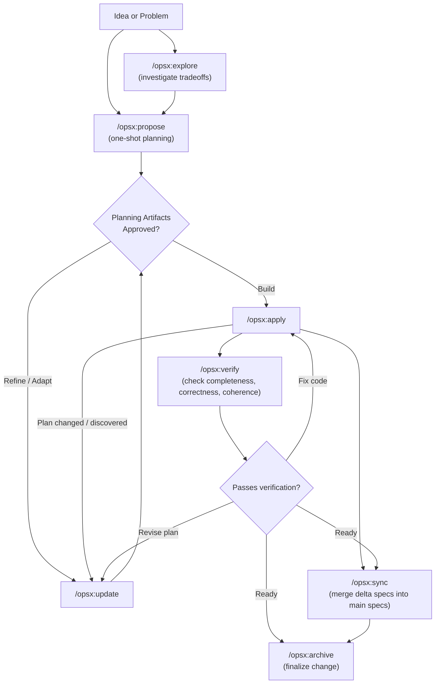

# OpenSpec Workflows Guide

Master reference for artifact-guided, spec-driven development with OpenSpec.

## Philosophy: Actions, Not Phases

Traditional workflows lock teams into rigid phases: *planning → implementing → done*. Real software evolution doesn't fit neatly into static boxes.

OpenSpec takes a fluid, action-driven approach:

```text
Traditional (phase-locked):
  PLANNING ────────► IMPLEMENTING ────────► DONE
      │                    │
      │   "Can't go back"  │
      └────────────────────┘

OpenSpec (fluid actions):
  proposal ──► specs ──► design ──► tasks ──► implement
      ▲                                            │
      └───────── update as discoveries happen ─────┘
```

**Core Principles:**
- **Actions, not phases**: Commands are actions you can invoke anytime, not sequential gates you are trapped in.
- **Dependencies are enablers**: Artifact dependencies define what is possible to do next, not what you must do next.
- **Strict planning boundary**: When generating planning artifacts (`propose`, `explore`, `ff`), never touch source code. Wait for explicit approval before running `apply`.

---

## 🧭 Live Orchestrator Dashboard

When asked *"What change am I working on?"*, *"Where is my work at?"*, or when orchestrating an existing workspace:

1. **Query Active State**:
   ```bash
   openspec list --json
   ```
   Inspect `changes` (names, completedTasks, totalTasks, status) and `root` path.

2. **Inspect Current Change Details**:
   ```bash
   openspec status --change "<name>" --json
   openspec instructions apply --change "<name>" --json
   ```
   Read:
   - Planning completion (`isPlanningComplete`)
   - Artifacts (`proposal`, `specs`, `design`, `tasks`) and their statuses (`done`, `ready`, `missing`)
   - Task completion progress (`completedTasks` / `totalTasks`)
   - Current pending tasks and next steps

3. **Present Status & Next Action**:
   State clearly:
   - **Active Change**: `<change-name>`
   - **Artifact Status**: which artifacts are complete vs pending
   - **Progress**: `N / M tasks complete (X%)`
   - **Current Lifecycle Phase**: Planning ➔ Implementation ➔ Verification ➔ Sync/Archive
   - **Recommended Next Command**: e.g., `/opsx:apply` to continue, `/opsx:verify` to audit, or `/opsx:archive` to finalize.

---

## Workflow at a Glance



---

## The Two Workflow Tracks

### 1. The Core Workflow (Fast & Recommended)
Use for standard feature work with predictable boundaries.

1. **`/opsx:explore`** *(Optional)*: Brainstorm options, explore dependencies, and align on direction without writing formal artifacts.
2. **`/opsx:propose "<name>"`**: Creates the change scaffold and generates all 4 planning artifacts in one pass:
   - `proposal.md` — What we're doing and why
   - `specs/<capability>/spec.md` — Delta specification (requirements + scenarios)
   - `design.md` — Technical decisions and architecture
   - `tasks.md` — Step-by-step implementation checklist
3. **Review & Approve**: Human reviews the generated artifacts. If revisions are needed, run `/opsx:update`.
4. **`/opsx:apply`**: Executes code changes step-by-step according to `tasks.md`, checking off boxes as tasks complete.
5. **`/opsx:archive`**: Prompts to sync delta specs into `openspec/specs/` and moves the change to `openspec/changes/archive/<date>-<name>/`.

---

### 2. The Expanded Workflow (Fine-Grained Control)
Use when building complex architectures, exploring novel patterns, or requiring human approval at every artifact layer.

1. **`/opsx:new "<name>"`**: Creates the empty directory structure under `openspec/changes/<name>/`.
2. **`/opsx:continue`**: Authors artifacts incrementally, pausing after each one for human feedback:
   `proposal.md` → human check → `spec.md` → human check → `design.md` → human check → `tasks.md`
   *(Or `/opsx:ff` to fast-forward all remaining artifacts if the scope becomes clear).*
3. **`/opsx:apply`**: Implements code against the task list.
4. **`/opsx:verify`**: Runs a 3-dimensional audit:
   - **Completeness**: Are all tasks checked and all spec requirements implemented?
   - **Correctness**: Do edge cases, error states, and scenarios match spec intent?
   - **Coherence**: Are architectural patterns from `design.md` respected in code?
5. **`/opsx:sync`**: Explicitly merges delta specs into the repository's permanent specifications.
6. **`/opsx:archive`** (or **`/opsx:bulk-archive`**): Moves completed changes to archive.

---

## Decision Trees: What Command to Choose

### Decision 1: `/opsx:ff` vs `/opsx:continue`

| Scenario | Recommended Command |
| :--- | :--- |
| Clear requirements, ready to move fast | **`/opsx:ff`** |
| Exploring new pattern, want review at each step | **`/opsx:continue`** |
| Want to review proposal before detailing specs | **`/opsx:continue`** |
| Tight deadline, clear scope upfront | **`/opsx:ff`** |
| High-risk or mission-critical architecture | **`/opsx:continue`** |

---

### Decision 2: Update Existing Change vs Start New Change

```text
                     ┌─────────────────────────────────────┐
                     │     Is this the same work?          │
                     └──────────────┬──────────────────────┘
                                    │
                 ┌──────────────────┼──────────────────┐
                 │                  │                  │
                 ▼                  ▼                  ▼
          Same intent?      >50% overlap?      Can original
          Same problem?     Same scope?        be "done" without
                 │                  │          these changes?
                 │                  │                  │
       ┌────────┴────────┐  ┌──────┴──────┐   ┌───────┴───────┐
       │                 │  │             │   │               │
      YES               NO YES           NO  NO              YES
       │                 │  │             │   │               │
       ▼                 ▼  ▼             ▼   ▼               ▼
    UPDATE            NEW  UPDATE       NEW  UPDATE          NEW
```

- **Update Existing (`/opsx:update`)**:
  - Same problem, refined approach
  - Implementation discovery revealed a necessary adjustment
  - Narrows scope (e.g. shipping core MVP first)
- **Start New Change (`/opsx:propose`)**:
  - Intent fundamentally changed
  - Scope expanded to unrelated subsystems
  - Original change can be merged and shipped standalone

---

## Best Practices

1. **Keep Changes Focused**:
   One logical unit of work per change. Avoid bundling feature additions with unrelated refactors. Separate changes make rollbacks easy and code review fast.

2. **Specs are Deltas**:
   The `specs/<capability>/spec.md` inside a change folder is a **delta** (changes/additions), not the entire system specification. Use `ADDED`, `MODIFIED`, or `REMOVED` sections.

3. **Verify Before Archiving**:
   Always run `/opsx:verify` before archiving to ensure no tasks were silently skipped and no design invariants were violated.

4. **Meaningful Change Names**:
   Use descriptive kebab-case names:
   - ✅ `add-dark-mode`, `fix-login-redirect`, `optimize-product-query`
   - ❌ `feature-1`, `update`, `wip`, `changes`

---

## Command Quick Reference

| Command | Skill Equivalent | Role |
| :--- | :--- | :--- |
| **`/opsx:explore`** | `openspec:explore` | Investigate problem space & tradeoffs |
| **`/opsx:propose`** | `openspec:propose` | One-shot proposal & artifact creation |
| **`/opsx:new`** | `openspec:new` | Initialize change scaffold |
| **`/opsx:continue`**| `openspec:continue`| Author next artifact step-by-step |
| **`/opsx:ff`** | `openspec:ff` | Fast-forward remaining artifacts |
| **`/opsx:update`** | `openspec:update` | Update existing change artifacts |
| **`/opsx:apply`** | `openspec:apply` | Implement tasks in code |
| **`/opsx:verify`** | `openspec:verify` | Audit implementation vs specs |
| **`/opsx:sync`** | `openspec:sync` | Merge delta specs into main specs |
| **`/opsx:archive`** | `openspec:archive` | Finalize and archive change |
| **`/opsx:bulk-archive`**| `openspec:bulk-archive`| Archive multiple completed changes |
| **`/opsx:onboard`** | `openspec:onboard` | Onboard team or project to OpenSpec |
