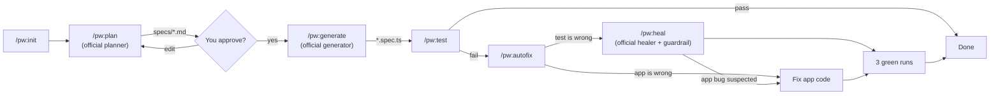

# Playwright Test Agents Plugin for Claude Code

A Claude Code plugin built on the official **Playwright Test Agents** ([playwright.dev/docs/test-agents](https://playwright.dev/docs/test-agents)).

Playwright ships three agents (planner, generator, healer) and an MCP server via `npx playwright init-agents --loop=claude`. This plugin **uses those agents rather than reimplementing them**, and adds what they don't do:

- **Fix the app, not just the test** (`autofix`). The official healer only edits tests, and skips a test (`test.fixme()`) when it thinks the app is broken. This plugin never skips; it fixes the app instead.
- **No-suppression guardrail** on every heal: skips, `fixme`, changed expected values and raised timeouts are reverted.
- **Human review gate** between plan and generation.
- **Persona flow discovery**, **visual + accessibility audits**, **fixtures**, and a **Linux focus-safe runner**.

**9 skills** (`playwright:*`) · **8 slash commands** (`/pw:*`).

---

## 🚀 Installation

```bash
/home/mejazbese21/Work/RndProjects/AgentSkills/plugins/playwright/install.sh
# or
claude plugin marketplace add /home/mejazbese21/Work/RndProjects/AgentSkills/plugins/playwright
claude plugin install playwright@playwright            # add --scope project for one repo
```

Then, in each project: run `/pw:init` and restart Claude Code so the `playwright-test` MCP server loads.

---

## ⚡ Slash Commands

Each command just invokes its skill. Their full names are `/playwright:pw:<command>` (e.g. `/playwright:pw:autofix`).

| Command | Skill | What it does |
| :--- | :--- | :--- |
| `/pw:init` | `init` | Installs Playwright, runs `init-agents`, fills in the seed test |
| `/pw:plan [feature]` | `planner` | Official planner explores the app → `specs/<feature>.md` → waits for your approval |
| `/pw:generate [plan]` | `generator` | Official generator turns the plan into tests, one scenario per file, then runs them |
| `/pw:test [args]` | `runner` | Runs tests, reports failures and skips |
| `/pw:heal [file]` | `healer` | Official healer fixes **test code**; guardrail reverts any suppression |
| `/pw:autofix [file]` | `autofix` | Decides app bug, test bug, flaky, or out of scope; fixes the **app** or the test; 3 green runs = done |
| `/pw:audit [route]` | `visual-a11y` | Screenshot regression + Axe WCAG 2.1 AA scan |
| `/pw:discover [module]` | `flow-discoverer` | Maps flows per persona → Mermaid + smoke plan in `specs/flows/` → generates smoke tests |

`fixtures` has no command; the other skills use it for login state, custom fixtures and network mocks.

---

## 🔄 The Loop



## 📁 Files in your project

| Path | Created by |
| :--- | :--- |
| `.claude/agents/playwright-test-*.md`, `.mcp.json` | `init-agents` (generated; re-run after upgrading Playwright, don't hand-edit) |
| `seed.spec.ts` (in `testDir`) | `init-agents`, filled in by `/pw:init` |
| `specs/<feature>.md` | `/pw:plan` |
| `specs/personas.md`, `specs/flows/<module>.md` | `/pw:discover` |
| `<testDir>/<feature>/<scenario>.spec.ts` | `/pw:generate` |

---

## 🔗 References

* [Playwright Test Agents](https://playwright.dev/docs/test-agents)
* [Playwright Best Practices](https://playwright.dev/docs/best-practices)
* [Accessibility testing](https://playwright.dev/docs/accessibility-testing)
